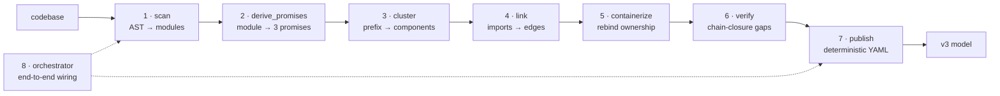

# AMS v3 — SE Walk Story

*How the v3 standard + tooling decompose, demonstrated by self-application to AMS.*

**Date:** 2026-09-14
**Branch:** `feat/phase-5-fanout-provenance-family5`
**Artifacts:** [.architecture-model.v3.yaml](../../.architecture-model.v3.yaml) · [v3 viewer](../../.architecture/viewers/v3_viewer.html) · [legacy viewer](../../.architecture/viewers/legacy_viewer.html)

---

## Level 0 — Concept

AMS is a **standard + tooling** for perfectly modeling *any* system.

- **The standard** is the v3 Promise-graph schema: components own typed Promises (`intent` / `delivers` / `provides`); relationships link components; typed gaps make missing verification explicit rather than hidden. Every entity carries auditable provenance.
- **The tooling** is `pipeline_v3` — a deterministic, composable extraction pipeline that produces a conformant v3 model from a codebase.

Self-application on AMS itself is the **validation strategy**, not the mission. If AMS can perfectly model AMS (a non-trivial 280-module system), the standard and tooling generalize. The self-model doubles as the reference implementation of what a "complete" v3 model looks like, and its declared open work becomes the roadmap.

**Success criteria — standard:** byte-deterministic output; auditable provenance per entity; open work declared as typed gaps; schema separable from pipeline (bring-your-own extractor still emits conformant v3).
**Success criteria — tooling:** reproducible on any Python repo without configuration; composable stages, each pure and testable in isolation; adapters preserve legacy consumers during migration.

## Level 1 — Two capabilities

The concept decomposes into two orthogonal capabilities:

| ID | Capability | Rationale |
|---|---|---|
| **CAP-PB** | Extract v3 model from a codebase | The *product* capability — what the tooling does. |
| **CAP-DF** | Evolve the standard + tooling themselves | The *meta* capability — how the standard is improved. Every T-task is one CAP-DF instance producing a CAP-PB increment. |

Separating "what the system does" from "how the system evolves" lets each be modeled and evolved independently.

## Level 2 — CAP-PB decomposes into 8 stages

Each stage is a pure function with a single responsibility. Determinism is enforced by pinning `AMS_DETERMINISTIC_NOW`; composability by returning a typed dataclass consumed by the next stage.

**Real numbers, pipeline_v3 on AMS itself** (pinned clock `2026-09-14T00:00:00Z`):

| # | Stage | Input → Output | Tests | Commit |
|---:|---|---|:---:|---|
| 1 | `scan` | 280 modules with dotted names | 11 | `2c969ee` |
| 2 | `derive_promises` | 280 × 3 = 840 raw promises | 14 | `ae0eaf7` |
| 3 | `cluster` | prefix-key → 24 COMP-* | 12 | `004cee2` |
| 4 | `link` | 442 import edges → 49 depends-on | 10 | `9e395d9` |
| 5 | `containerize` | rebind + dedup → 650 promises owned by components | 12 | `5a633bb` |
| 6 | `verify` | chain-closure over 650 promises → 596 open + 54 typed-gap | 12 | `d3c4ded` |
| 7 | `publish` | 367,913 bytes v3 YAML, byte-deterministic | 16 | `7a5c009` |
| 8 | `orchestrator` | `PipelineRunResult` binding all stages | 12 | `5566c57` |

## Level 3 — Each stage decomposes further (brief)

- **`scan`** splits into: `generate_manifest` bridge → `_dotted_name(file, repo_root)` derivation → `ScannedModule` records. Discovery: manifest returns display names ("Mod"), not dotted paths — bridge normalizes via `path.relative_to(repo_root)`.
- **`derive_promises`** splits into: extractor per attribute (`intent` from docstring, `delivers` from public function/class names, `provides` from public constants) → deterministic Promise id via `compute_promise_id(SHA-256 over owner+attribute+content)`.
- **`cluster`** splits into: prefix-key computation at configurable depth (default 3) → SHA1-derived stable COMP-* id → module-count-weighted centroid.
- **`link`** splits into: import-edge extraction → root-prefix normalizer (handles the `src.` prefix asymmetry between scanned modules and unqualified imports) → longest-prefix wins.
- **`containerize`** splits into: module→component rebind → per-component dedup by `(attribute, content_hash)` → root-owner convention (all component ids treated as roots for verify).
- **`verify`** splits into: chain-closure bridge (`architecture_model.quality.chain_closure.analyze_chain_closure`) → per-component roll-up → typed-gap emission (`no-public-functions`, `no-public-classes`, `missing-intent`).
- **`publish`** splits into: canonical key order → sort by (component id, promise id, edge from/to) → YAML emit with `sort_keys=False` + `default_flow_style=False` → byte-determinism guard.
- **`orchestrator`** is a Kahn-topological invocation of the seven stages returning `PipelineRunResult(model_path, model, containerized, verify_report)`.

## Level 4 — Next step and onwards

Once CAP-PB was operational at Phase 6, the walk continued **outward** (not deeper), each phase a CAP-DF cycle instance:

| Phase | Purpose | Proof it delivered | Commit |
|:---:|---|---|---|
| **7** | Emit the self-model as a committed artifact | `.architecture-model.v3.yaml` — 24 components, 650 promises, 49 edges, 367KB, byte-deterministic under pinned clock | `5d33b3e` |
| **8** | CI-enforce structural coherence + determinism | 15 gates: schema version, required fields, id uniqueness, promise-id determinism (`compute_promise_id` re-derivation), typed-gap invariants, byte-determinism round-trip | `bbc922c` |
| **9** | Focused views for downstream LLM consumers | v3-native `slice_by_component` / `slice_by_promise`; real-data test: 369KB → 44KB (8.4×) on `COMP-1896b055` (core), 17-component neighborhood preserved | `c1358b6`, `80c872a` (wire-shape fix caught by smoke test) |
| **10** | Retire 2.x parser cleanly | `DeprecationWarning` from `load_model` / `_parse_raw` pointing callers at `pipeline_v3`; behavior preserved; 119/119 core tests still pass | `813842f` |
| **11** | Preserve legacy consumers during migration | Three adapters — `v3_to_legacy_model`, `render_diagrams_from_v3`, `generate_docs_from_v3`; real-data: 24-component 2.x model + 1 diagram + 25 doc pages | `800ae45` |

Each Phase 7-11 commit ran the CAP-DF loop: **INTAKE** (what does this phase need to prove?) → **GENESIS** (write failing tests) → **WALK** (implement, TDD) → **EVOLVE** (real-data smoke test + commit). Phase 9.1 is the walk visible in miniature — the smoke test in Phase 11 caught a wire-shape bug in Phase 9's slicer, which was fixed as a follow-up commit rather than an amend.

## Level 5 — Where the walk continues

Two directions:

**Inward — the 54 typed gaps + 596 unverified promises are the AMS roadmap.**
Every promise the self-model has declared is either verified (via test-contract cross-linkage), open (unverified but well-formed), or typed-gap (declared missing, with a machine-readable reason: `no-public-functions`, `no-public-classes`, `missing-intent`). Nothing is invisible tech debt; the roadmap is queryable via `slice_by_promise` in the v3 viewer. Filter the [v3 viewer](../../.architecture/viewers/v3_viewer.html) by "gaps only" to see them.

**Outward — the standard + tooling apply to any codebase.**
`pipeline_v3.orchestrator.run_pipeline(repo_path)` is not AMS-specific. Running it on an external Python repo produces a conformant v3 model on the same terms; the Phase 8 gates apply identically; the slicer and adapters work over any conformant v3 dict. External validation of the standard is the natural next-outward CAP-DF cycle.

---

## Two viewers, two lenses

- **v3-native viewer** ([open](../../.architecture/viewers/v3_viewer.html)) — Promise-graph lens. Left rail: 24 components sortable by id/name/promise-count/gap-count with search + gaps-only filter. Center: promises grouped by attribute with status badges (green=verified, amber=open, red=typed-gap) and hover-provenance. Right: depends-on neighbors, clickable to navigate.
- **2.x adapter viewer** ([open](../../.architecture/viewers/legacy_viewer.html)) — Classic box-and-arrow SE lens rendered via the Phase 11 adapter. Familiar C4-style component + edge diagrams. Drops v3-native data (Promises, gap types, delivered_from) — useful as a comparison to see what v3 adds.

Both viewers are single self-contained HTML files. No build step. Rebuild via `python scripts/build_v3_viewer.py` and `python scripts/render_v3_in_legacy_viewer.py`.

---

*This report is the SE walk story of the v3 standard + tooling: concept → 2 capabilities → 8 stages → per-stage decomposition → outward extension arc → declared roadmap. Everything shown is reproducible from the pipeline output at `.architecture-model.v3.yaml` under the pinned clock.*
