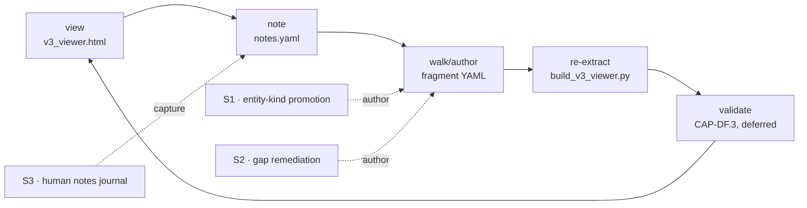

# AMS v3 — Dev Workflow SE Walk

*Extends [2026-09-14 v3 SE walk](2026-09-14-v3-se-walk.md). Preserves the CAP-PB / CAP-SL / CAP-DF framing. Adds the human-in-the-loop dev workflow and the LLM seams that close the 1-of-7 entity-kind gap.*

**Date:** 2026-09-15
**Branch:** `feat/phase-5-fanout-provenance-family5`
**Artifacts:** [`.architecture/model/capabilities.v3.yaml`](../../.architecture/model/capabilities.v3.yaml) · [v3 viewer](../../.architecture/viewers/v3_viewer.html) · [prior walk](2026-09-14-v3-se-walk.md)

---

## Level 0 — Concept (extended)

The 2026-09-14 walk framed AMS as **standard + tooling** and validated it via self-application. This walk answers the next question: **how does a developer/SE actually use the standard + tooling day-to-day to converge on complete architectural insight?**

The answer is a loop, not a batch job:

```
view → note → walk/author → validate → re-extract → view …
```

The developer opens the viewer, spots a missing / stale / wrong entity, drops a human note, authors a fragment YAML (or invokes an LLM seam to author it), re-runs the pipeline, and validates the result. Each iteration is a one-commit CAP-DF cycle. Commits `1a721a5` (viewer + notes) and `ef632b9` (capabilities.v3.yaml walk) are two loops of this workflow, done by hand.

**Success criterion:** the loop is short enough that a full pass fits in one context window and one commit, and every artifact produced (viewer HTML, notes.yaml, fragment YAML) is byte-deterministic and diffable.

## Level 1 — Two workflow capabilities

Both are refinements of CAP-DF from the prior walk:

| ID | Capability | Rationale |
|---|---|---|
| **CAP-DF.1** | Graph-walk-as-capability — human/LLM authors declarative fragments | Walks are executable capabilities, not documentation. Output: `.architecture/model/*.v3.yaml` fragments merged at view time. |
| **CAP-DF.2** | View — interactive review + note-taking | The viewer is the front door. Any Promise attribute renders; notes save as a YAML journal (S3 seam). |

CAP-DF.3 (validate) and CAP-DF.4 (LLM seams) sit alongside; they were declared open in `capabilities.v3.yaml` and remain the roadmap.

## Level 2 — The loop decomposed



Three seams (S1, S2, S3) live on the loop:

- **S3 · human notes journal** — landed in Commit `1a721a5`. Viewer emits a `notes.yaml` blob on Save; developer places it under `.architecture/viewers/`; future re-extractions can consume it as authored evidence.
- **S1 · entity-kind promotion** — Part 3 mainline. LLM proposes capabilities / behaviors / interfaces / actors / constraints / layers from `scan` + `derive_promises` output, promotes them into fragment YAML.
- **S2 · gap remediation** — Part 3 secondary. LLM inspects `verify` typed-gaps + open promises and proposes remediation authoring.

## Level 3 — Slicing as prompt substrate

The v3 slicer (`pipeline_v3/slice.py`, IF-slicer in the capability tree) is not just a diagram helper — it is the **prompt substrate** for both LLM seams. `slice_by_component` / `slice_by_promise` compress the 367KB self-model to a 44KB focused view (8.4× per Phase 9). Every S1/S2 prompt begins with a slice, not the full model. Consequence: LLM seams inherit CAP-SL's byte-determinism, so seam outputs are diffable across runs.

## Level 4 — The entity-kind gap (evidence)

The v3 pipeline emits only **1 of the 7 entity kinds** the schema supports. Direct cite:

- `src/architecture_model/pipeline_v3/publish.py:107` — writes `entities: {"components": components}` verbatim, no capabilities / behaviors / interfaces / actors / constraints / layers slot.
- `src/architecture_model/pipeline_v3/derive_promises.py:51-98` — emits exactly 3 attributes (`intent` / `delivers` / `provides`). Schema 2.1 defined 14 (`intent`, `goals`, `stakeholders`, `success_criteria`, `failure_modes`, `trade_offs`, `assumptions`, `open_questions`, `requirements`, `verification`, `slos`, `owner`, `maturity`, `dependencies_rationale`).

Neither is a schema constraint. `spec/promise-graph.schema.json` places no enum on `attribute`; `core/promise.py:101` accepts any non-empty string. The gap is a **pipeline emission choice**, and closing it is what BEH-S1 exists to do.

Commit 2 (`ef632b9`) demonstrated the gap can be closed **by hand** for capabilities, behaviors, and interfaces via a fragment YAML merged at view time (`build_v3_viewer.py` fragment-merge step). BEH-S1 automates the same authoring using LLM + slice-based prompts. BEH-S2 does the analogous job for open / typed-gap promises. Together with S3, the three seams cover the seven stages: S1 covers stages 1–3 (scan / derive_promises / cluster) outputs, S2 covers stages 4–6 (link / containerize / verify) outputs, and S3 covers stage 7 (publish) outputs as human commentary.

## Level 5 — Where the loop goes next (roadmap)

**Inward — the seams demand concrete plumbing.** The `LLMProvider` protocol at `src/architecture_model/llm/provider.py` has zero AMS-side usages today, and `.architecture/llm/policy.yaml` referenced in CONTEXT.md does not exist. Part 3 lands both: a concrete provider adapter (frontier or MCP-relay), a policy file with per-seam budget caps, and an S1 prototype that promotes capabilities / behaviors from a scan output over a single subsystem. Success criterion: S1 reproduces the CAP-PB decomposition of `capabilities.v3.yaml` from `pipeline_v3` output alone, byte-deterministically under a pinned seed.

**Outward — the loop applies to any v3 model.** Once S1 works on AMS, it works on any codebase whose `pipeline_v3` output conforms. The viewer already renders any Promise attribute; the fragment-merge step is content-agnostic; the notes journal is generic. External validation of the dev workflow is the next-outward CAP-DF cycle after Part 3.

**Deferred but declared.** Promoting the fragment-merge step from `build_v3_viewer.py` into `publish.py` (so `.architecture-model.v3.yaml` itself carries authored fragments, not just the viewer payload) is a follow-up to BEH-S1; today it is intentionally viewer-side to preserve `publish.py`'s wholesale-overwrite invariant and its byte-determinism gate.

---

## Two seams that already work, one that's next

- **S3 (delivered, `1a721a5`)** — Viewer Save button emits `notes.yaml`. Human placement into `.architecture/viewers/`.
- **CAP-DF.1 walk (delivered by hand, `ef632b9`)** — `.architecture/model/capabilities.v3.yaml` merges into the viewer payload, adds capabilities / behaviors / interfaces / requirements / failure_modes attributes.
- **S1 + S2 (Part 3)** — declared as CAP-DF.4 in the capability tree, tracked as unrealized typed gaps in the v3 viewer.

The self-model now declares its own dev workflow. Every future workflow improvement is one more CAP-DF cycle on the same loop.

---

*This report extends the 2026-09-14 walk. It does not reframe CAP-PB / CAP-SL / CAP-DF; it adds the workflow lens on top and cites the entity-kind gap as the concrete next step. Everything shown is reproducible from `.architecture-model.v3.yaml` + `.architecture/model/*.v3.yaml` under the pinned clock.*
